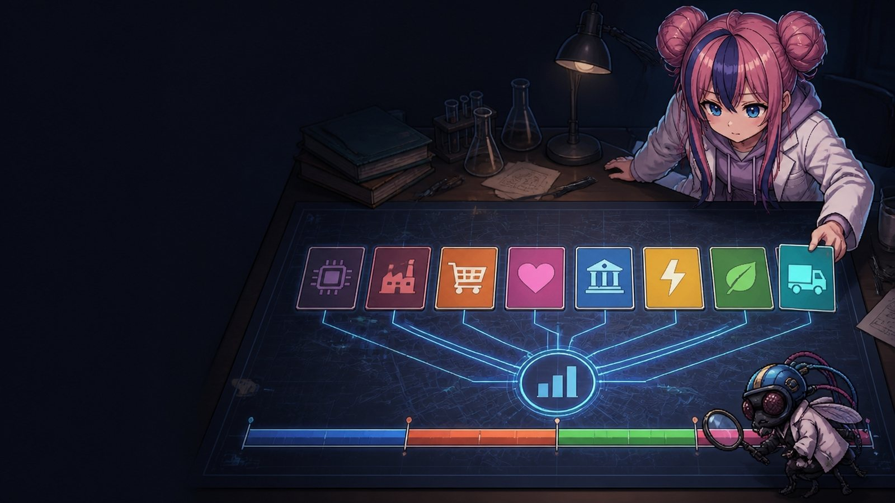

> 📄 **원문 논문:** [우리나라 주식시장의 변동성 분해 분석 : 산업별·기간별 변동성 분해 분석과 수익률 효과 분석](https://dcol.dongguk.edu/srch/srchDetail/000000054279) — 안상선, 동국대학교 박사학위논문, 2012

# 챕터 2 · 연구 설계와 데이터

**우리나라 주식시장의 변동성 분해 — 연구실 해설** — 「우리나라 주식시장의 변동성 분해 분석 : 산업별·기간별 변동성 분해 분석과 수익률 효과 분석」 해설 · 글 · 안상선 ((주)M-Robo 대표)

*논문 1장 서론, 3장 선행연구, 4장 연구 모형(pp.1-6, 39-100)*

챕터 2는 논문이 무엇을, 어떻게, 언제 보았는지를 정리한다. 선행연구의 지도에서 빈칸(섹터지수 변동성 분해)을 찾고, KOSPI200 섹터지수 8개와 세 가지 연구 질문을 세운다. 질문마다 식(GARCH-M, 상태공간 분해, 기여도 회귀, 수익률 효과 모형)을 정하고, 1,245일을 네 기간으로 나눈 근거를 Chow 검정으로 확인한다. 마지막 두 쪽은 원문 표 4.4~4.27의 실제 숫자, 기초통계량·Ljung-Box Q·상관 행렬을 직접 펼치고 검산한다.

👉 **[목차 열기 (index.html)](index.html)**

## 쪽 목록

| 쪽 | 제목 | 질문 |
|---|---|---|
| [2-1](2-1_literature-map.html) | 선행연구 지도 | 앞선 연구들은 무엇을 밝혔고, 무엇이 비어 있었나? |
| [2-2](2-2_sector-questions.html) | 섹터지수와 연구 질문 | 왜 시장 전체가 아니라 섹터지수를 보았고, 무엇을 물었나? |
| [2-3](2-3_research-model.html) | 연구 모형 | 세 질문에 답하려면 어떤 식을 어떤 순서로 세워야 하나? |
| [2-4](2-4_periods-chow.html) | 표본 4기간과 Chow | 금융위기 전후를 한 표본으로 섞어도 될까? |
| [2-5](2-5_descriptive-stats.html) | 기초통계량 | 업종과 기간마다 수익률의 모양은 어떻게 다르고, 원문 숫자는 서로 맞을까? |
| [2-6](2-6_independence-correlation.html) | 독립성 검정과 상관 구조 | 오늘 수익률은 어제를 닮고, 업종들은 서로를 닮는가? |

## 읽기 전에

2-5·2-6의 표·막대·행렬은 원문 표 4.4~4.27의 실제 숫자입니다(일별 원자료는 PDF에 없어 표 값만 씁니다). 2-1~2-4의 실험과 2-5·2-6의 대결 일부는 설명용 모의 자료입니다. 원문 표끼리 서로 맞지 않는 곳 11군데를 찾아 해당 쪽에 표시했고, Jarque-Bera 재계산으로 에너지·화학 2기 첨도의 오기를 확인했습니다.

## 쪽의 구성

각 쪽은 **왜 → ① ~ ④ 단계(비유 → 원문 서술 → 직접 움직여 보는 그림 → 풀이) → 대결(초파리 vs Money-Robo) → 정리 → 마무리** 순서로 진행합니다. 쪽마다 퀴즈, 출처 번호, 지식 그래프(JSON-LD·Turtle·BibTeX 내려받기)가 들어 있습니다.

## 캐릭터

| 캐릭터 | 역할 |
|---|---|
| 박사 | 설명과 정리 |
| 하루(조수) | 계산과 해석 |
| 초파리 연구원 | 의심과 검증 |
| Money-Robo | 빠른 결론, 자주 틀림 (말버릇은 투자 조언이 아님) |

## 보기

**바로 보기** — 저장소를 내려받아 `index.html`(챕터 목차)을 브라우저로 열면 됩니다. 페이지마다 그림·스타일·스크립트가 한 파일에 들어 있어 따로 설치할 것이 없습니다(글꼴만 Google Fonts에서 불러옴).

**GitHub Pages** — 저장소 Settings → Pages → Branch `main` / `(root)`로 두면 `https://<계정>.github.io/<저장소>/`에서 열립니다.

## 시리즈

- 챕터 1 · 변동성 이론
- 챕터 2 · 연구 설계와 데이터
- 챕터 3 · 실증 결과와 결론

## 라이선스

(미정)

---
글 · 안상선 ((주)M-Robo 대표) · 해설 제작에 AI 보조 도구를 사용했습니다.
